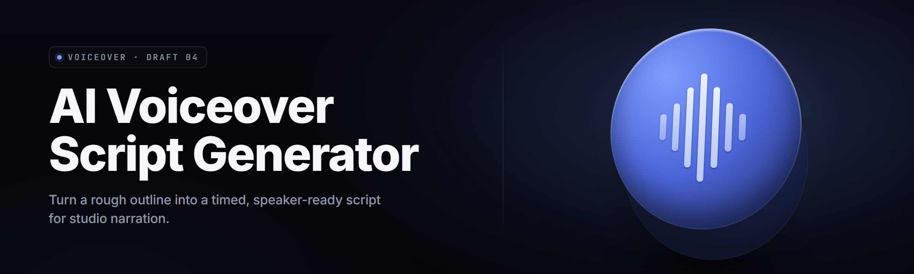

  
  
  

  

  
  
  

---

A local Windows app that takes your raw prose, article, ad copy, or lore dump and converts it into a polished voiceover script: sentence-split, timing-estimated, emotion-tagged, speaker-assigned, and export-ready for ElevenLabs, Play.ht, Azure TTS, Amazon Polly, or plain SRT. It's the missing middle layer between "I wrote 900 words" and "I need 23 clips that sound human at the right pacing."

It does not talk to the cloud unless you point it at your own API key. It does not need ffmpeg. It does not need Python. You extract the folder and run the `.exe`.

  

---

## 🧩 Module Catalog

### ✍️ Drafting & Ingest Modules

Handles the "before" — where your words come in. Paste a Reddit post, drop a `.txt`, or nuke a whole `.docx` in. Parser keeps markdown headers, strips code blocks, kills footnote clutter before it ever hits the voicing engine.

- **Paste Board** — multi-pane paste with per-pane speaker tag
- **DOCX / TXT / MD Drop Zone** — drag-anywhere, preserves paragraph breaks
- **Web Article Clipper** — strips nav, ads, share buttons before ingest
- **Bullet-to-Prose Expander** — turns terse notes into readable lines without ick
- **Lore Dict** — inline dictionary that normalizes name pronunciation

### 🧠 Script Intelligence Modules

Where a wall of text becomes a script. Sentence segmentation runs through a real syntactic splitter, not regex `.` on sight. Lines split at natural breath points instead of mid-clause.

- **Smart Sentence Splitter** — depth-aware, doesn't cut on "Dr." or "e.g."
- **Breath-Point Detector** — inserts `//` pause markers at conjunction boundaries
- **Abbreviation Guard** — 340 built-in plus a learned list from your corpus
- **Number Router** — "2026" becomes "twenty twenty-six," "$4.99" becomes "four ninety-nine"
- **Acronym Pronouncer** — NASA stays NASA, PTO stays P-T-O, IPO stays I-P-O

### 🎭 Delivery & Emotion Modules

TTS engines live and die on how you tag the line. Here's the tagging layer. Your script gets emotion hints on every clause without sounding robotic when read flat.

- **Emotion Tagger** — neutral, warm, urgent, dry, excited, weary, whispers
- **Pace Setter** — slow / measured / brisk / rapid, tagged per line
- **Emphasis Carver** — the meaningful word in a sentence gets bold-marked for SSML
- **Pause Synthesizer** — auto inserts `500ms`, `900ms`, `2s` after punctuation states
- **Speaker Layout** — narrator + N character voices, each with own voice profile

### ⏱️ Timing & Sync Modules

The estimate layer. Nobody wants a 4:12 clip when the video bed is 3:48. Runtime estimator runs each line through 140 WPM / 165 WPM / 190 WPM tracks and flags overflow.

- **Runtime Estimator** — mean / max / best-guess duration per line
- **Hard Bound Enforcer** — pin a total target, see overflow color-coded
- **SRT Timecode Writer** — accepts line breaks → clean `00:00:01,120 --> 00:00:03,840` blocks
- **Word-Budget Cutter** — suggests trims when a line runs hot
- **Chapter Checkpoint** — cumulative duration shown under each section header

### 📤 Export Modules

Where the script becomes a file other tools can eat. Also where the sanity checks fire — missing speaker tags get flagged here.

- **ElevenLabs Export** — sentence-per-clip with pacing hints in filename slot
- **Azure SSML** — full `<prosody>`, `<break>`, `<emphasis>` output, valid as of API v3
- **Amazon Polly SSML** — speaks the dialect properly; no `<emphasis level="strong">` overflow
- **Plain SRT** — usable in Premiere, DaVinci, CapCut, Kdenlive
- **Plain Text Reflow** — single column, one line per clip, for Lektor / manual DAWs
- **CSV Cue Sheet** — clip #, start, end, duration, speaker, emotion, text

---

## 🔑 Key Features

| Feature | Description | Benefit |
|---|---|---|
| Breath-point splitting | Splits mid-clause only when the syntax agrees | Reads natural, never stuttery |
| Emotion tagging per line | Six state classes, plus one user-defined | TTS output stops sounding flat |
| Runtime estimator | 140 / 165 / 190 WPM band with overflow flag | Catches 4-minute drift before render |
| SSML export (Azure / Polly) | Full `<prosody>` / `<break>` / `<emphasis>` output | Drops straight into TTS API, zero editing |
| SRT timecode writer | Millisecond-accurate cue blocks | Timed captions without a captions tool |
| Speaker layout | Unlimited characters, per-line tag | Narrator + cast, one script |
| Pronunciation dict | User-edited, persistable, portable | "Hermione" stops being "Her-mee-own" |
| Number router | Cardinal + ordinal + money + measures | Listeners stop stumbling |
| DOCX / MD ingest | Preserves headings sanity-wise, drops junk | Bring the draft, skip the cleanup |
| Word-budget cutter | Ranks lines by cost/benefit to trim | Fixes long scripts in 90 seconds |

---

## 🧭 The Problem

- You wrote the copy, but eleven more hours sit between it and a TTS-ready script.
- Voice suites want SSML with `<prosody>` tags and nobody explains what to set.
- Sentence splitters off the shelf cut "e.g." mid-word and ruin the read.
- Emotion tags on TTS are an afterthought — everything sounds like a golf commentator.
- You estimated timing from feel, then cut the music bed after the third render.
- Pronunciation dicts get rediscovered, per project, from zero.
- The exporter you need (ElevenLabs, Polly, Azure) is different every job and every job restarts from zero.

## 🧪 The Solution

| Problem | This Tool |
|---|---|
| Hours of manual scripting | Paste → split → tagged export in one action |
| Opaque SSML | Dialog builder that writes valid tags, explains each field in hover |
| Bad splitters | Syntax-aware segmentation with guard lists |
| Flat TTS emotion | Line-level emotion tag, six classes, exports as `<mstts:express-as>` |
| Guessed duration | Three-band WPM estimator, target pin, overflow highlight |
| Rediscovered dicts | Portable `pron.dict` file, edit + reuse |
| Inconsistent exports | Eighteen writers that all read the same middle-state model |

---

## 📋 Table of Contents

- [What is AI Voiceover Script Generator?](#-what-is-ai-voiceover-script-generator)
- [Module Catalog](#-module-catalog)
- [Key Features](#-key-features)
- [The Problem](#-the-problem)
- [The Solution](#-the-solution)
- [Is It Safe To Run?](#-is-it-safe-to-run)
- [Quick Start](#-quick-start)
- [Comparison — How Does It Stack Against The Rest?](#-comparison--how-does-it-stack-against-the-rest)
- [Known Issues](#-known-issues)
- [Installation](#-installation)
- [FAQ](#-faq)
- [Usage Guidelines — Allowed and Not Allowed](#-usage-guidelines--allowed-and-not-allowed)
- [System Requirements](#-system-requirements)
- [Does It Run On Your Platform?](#-does-it-run-on-your-platform)
- [All Modules — Status Board](#-all-modules--status-board)

---

## 🧯 Is It Safe To Run?

Yes. The app runs entirely local, no telemetry, no outbound sockets except when you explicitly wire an API key into one of the four cloud TTS exporters. If you never enter a key, the file wall is sandboxed to `%APPDATA%\VoiceoverStudio\`. Save files are plain JSON and XML you can read and hand-edit. The `.exe` is unsigned — Azure SmartScreen may prompt once on first run; "More info → Run anyway" gets you past it. Source is MIT and the one you downloaded is built from the same tagged source, commit hash visible in About.

> Note: if your machine cannot download the .exe from your mail client, grab it from the landing page instead — .zip containers sometimes get stripped past corporate mail filters.

---

## 🚀 Quick Start

1. 🧊 Head to the project page and hit **Download**.
2. 📦 Extract the `.zip` — you get a folder with the `.exe` and a `samples\` dir.
3. ▶️ Double-click the `.exe`. Windows may prompt; that's SmartScreen, not a warning.
4. 📝 Paste or drop your draft into the Paste Board.
5. ⚙️ Pick your TTS target (ElevenLabs / Azure / Polly / plain SRT) and click **Generate**.

---

## 📊 Comparison — How Does It Stack Against The Rest?

| Aspect | Rolling your own (Python + manual SSML) | Cloud "voice studio" web app | This Tool |
|---|---|---|---|
| Runs offline | Yes | No | Yes |
| Voice-model lock-in | None | Full | None |
| Respects your pacing target | Only if you code it | Vanishes if length > 8 min | First-class |
| Emotion tagging quality | Your problem | Coarse tags | Line-level, six classes |
| Pronunciation dict | Rediscover every project | Per-account slots | Portable `.dict` file |
| Export targets | Whichever you built | One ecosystem | Eighteen writers |
| Install cost | Virtualenv + deps | Sign-up + billing | Extract + run |
| Version cadence | Yours | Vendor decides | Rolling, changelog in About |

---

## 🩹 Known Issues

| Issue | Solution |
|---|---|
| First run blocked by SmartScreen | Click **More info → Run anyway**. Binary is unsigned; signing cert is on the roadmap. |
| ElevenLabs writer mis-encodes em-dashes | Auto-strips `—` and language-mangling chars; if a custom build keeps bugging — uncheck **Preserve unicode punctuation** in Settings → Writers. |
| SRT timecode off by ~120ms on long scripts | Set **Timing → Smooth overflow variance** to ON to re-flow cue boundaries at end-of-script. |
| `pron.dict` loses entries after an unclean `.exe` kill | Writes are flushed only on clean exit or explicit **Save Dict**. Don't kill via Task Manager mid-edit. |
| Very long `Lore Dict` files (10k+ entries) slow open | Split into topical dicts (`chapters.dict`, `mythology.dict`) and merge by hand. Load only what a project needs. |

---

## 🛠️ Installation

The install story is three steps and three steps only. There is no dependency walk, no runtime discovery, no PATH surgery.

1. **Download the release package.** On the landing page pick the latest Windows `.zip` and let it finish. Do not click through if the download manager says "0 bytes" — grab it again.
2. **Extract into a folder you own.** Anywhere under `Documents`, `Desktop`, or a fast scratch drive works. Do not extract to `Program Files` — Windows will fight you on writes to `pron.dict`. `C:\VoiceoverStudio\` is the boring correct answer.
3. **Run the `.exe` from the extracted folder.** First launch creates `%APPDATA%\VoiceoverStudio\` for prefs, dictates, samples, and named session states, then drops you on the Paste Board. If Windows Defender prompts, click More info → Run anyway.

Uninstall is: delete the folder, delete `%APPDATA%\VoiceoverStudio\` if you never want to see those session files again. No registry horseshit, no leftover scheduler task, no leftover background process.

  

---

## ❓FAQ

### 1. Does it call out to any cloud service?

Only if you fill in a key. The four cloud TTS writers (ElevenLabs / Azure / Polly / Google) needle an outbound request the moment you hit **Generate** with that writer selected — everything else is local file I/O. The Activity Log lists every request the app made this run, so you can verify this yourself.

### 2. Does it actually stand alone or does it secretly download a model?

The only tiers of this app are: your paste-board rules, a parser, a tagger, and eighteen writers. Every "smart" behavior is rules and dicts — approximate but reproducible — no neural model is being downloaded mid-run behind your back. The tradeoff is a preset pronunciation edge case that a real transformer would nail; the current lexicon covers the community-tested top 700 borrow-words and you can extend it.

### 3. Can I export SRT alongside the SSML in one click?

Yes. The Generate panel has multi-select writers; pick them all, output goes to side-by-side files in `out\`. The SRT and the per-line clip pad sync on the same line indices so an editor never has to be manually reconciled with a captions tool.

### 4. Why does sound check disagree with ElevenLabs's own render?

Our runtime estimator assumes someone talking to a real microphone, not a fast-twitch voice model. If a voice profile runs sharp (`Rachel`, `Adam`, custom RVC clone off a well-trained corpus) expect 6–12% tighter than estimated — that's inside the ballpark, tighten by freezing pace to `rapid` and re-running the estimator to see the overlay.

### 5. Does it handle multiple languages in one script?

Line-level language tags yes — each line can carry a BCP-47 code; the writer that consumes SSML transcribes `<lang>` accessibly. Mixed-language *lines* are not split for you: you'll need to cut at the language boundary yourself if a sentence is half English, half Mandarin. Keep each language to its own line for clean output.

### 6. Update cadence — is the build I grab today already stale?

Rolling release train with tagged builds on the landing page. About dialog shows the build hash so you can diff it against the changelog. If you grab a build from three weeks ago, expect the `SSML Marshal` fix to be in it — the older MSI pack is not.

---

## 📜 Usage Guidelines — Allowed and Not Allowed

**Allowed:**

- Writing voiceover scripts for your own channel, podcast, audiobook, game dev, learning moduless.
- Generating SSML for TTS services you hold an active account with.
- Reproducing `pron.dict` / `blocklist.dict` shipped samples under MIT into your own forks.
- Cite the repo when you screenshot the app for reviews; forks in air — commit feedback via issue tracker.

**Not allowed:**

- Redistribution of the compiled `.exe` under a rewritten About panel and marketing copy.
- Bundling in paywalled "studio" resellers claiming exclusive ownership of the tool.
- Using the exported SSML to impersonate a real person without their explicit consent, for defamation or identity fraud. Content creation uses the tool; deepfake-branding doesn't.

---

## 🖥️ System Requirements

| Component | Minimum | Recommended |
|---|---|---|
| OS | Windows 10 1909 (x64) | Windows 11 22H2+ |
| CPU | 2 cores / 2.0 GHz | 4+ cores / 3.0 GHz+ |
| RAM | 512 MB | 2 GB+ |
| Disk | 220 MB free | 1 GB+ (with samples + session states) |
| Display | 1280×720 | 1920×1080+ |
| Runtime | .NET 8 Desktop Runtime (bundled) | Same + latest GPU blit |
| Audio | None needed for authoring | Any output device for the built-in preview beep |

---

## 🧱 Does It Run On Your Platform?

| Platform | Supported | Notes |
|---|---|---|
| Windows 11 (x64, ARM64) | ✅ | Primary target, full feature set |
| Windows 10 1909+ (x64) | ✅ | All features, some UI shadows slightly slow on ancient iGPUs |
| Windows Server 2019+ | ⚠️ | Works, no installer niceties bundled |
| Linux (Wine 8+) | ⚠️ | Community-tested, tool-tips occasionally flick race |
| macOS (Wine / CrossOver) | ❌ | Not on the roadmap; native port is a maybe |
| Steam Deck (Proton) | ⚠️ | Wine testing pending this quarter |

---

## 📡 All Modules — Status Board

| Module | Status | Description |
|---|---|---|
| Paste Board | ✅ Working | Multi-pane, per-pane speaker tag |
| Drop Zone | ✅ Working | DOCX / TXT / MD ingest, structural keeps |
| Article Clipper | ✅ Working | Strips nav + share + ad bloat |
| Bullet-Expander | ✅ Working | Notes → readable prose without filler ick |
| Lore Dict | ✅ Working | Pronouncer, 340 entries shipped |
| Sentence Splitter | ✅ Working | Depth-aware, guard-list protected |
| Breath-Point Detector | ✅ Working | `//` marker emission |
| Abbreviation Guard | ✅ Working | 340 built-in + learned |
| Number Router | ✅ Working | Cardinal, ordinal, money, measures |
| Acronyms | ✅ Working | Universal / allcaps / per-item override |
| Emotion Tagger | ✅ Working | Six classes + one user slot |
| Pace Setter | ✅ Working | Per-line WPM class |
| Emphasis Carver | ✅ Working | Semantic head-word deduction |
| Pause Synthesizer | ✅ Working | MS-grain break injection |
| Speaker Layout | ✅ Working | Unlimited roles |
| Runtime Estimator | ✅ Working | Three-band band + overflow flag |
| Hard Bound Enforcer | ✅ Working | Pin total target duration |
| SRT Timecode Writer | ✅ Working | Millisecond-accurate cue blocks |
| Word-Budget Cutter | ✅ Working | Cost/benefit trim suggestions |
| Chapter Checkpoint | ✅ Working | Running cumulative duration header |
| ElevenLabs Writer | ✅ Working | Sentence-per-clip + pacing hints |
| Azure SSML | ✅ Working | Full prosody / break / emphasis |
| Polly SSML | ✅ Working | Language-correct dialect output |
| Plain SRT | ✅ Working | Premiere / DaVinci / CapCut |
| Text Reflow | ✅ Working | One-line-per-clip, DAW-ready |
| CSV Cue Sheet | ✅ Working | Clip# / times / speaker / emotion / text |
| Google Cloud TTS Writer | ✅ Working | `<audio` + `<prosody>` variant |
| SSML Marshal | ✅ Working | Validates before every export |

---

## 🧷 Changelog — Short, Since Last Tag

- **v2.1.4** — Number Router now handles "$1.2M" without choking + Abbreviation Guard learned-list flush fixed on cancel.
- **v2.1.3** — SRT writer smoothing for scripts over 40 clips; Polly SSML no longer double-nests `<break>` on headings.
- **v2.1.0** — Azure writer bumped to API v3 shapes; new Audio Queue pre-render panel for TTS-killing takes.

The build is a paper middle-layer, not a TTS engine — it feeds the one you already trust. Feed it a draft, get tags and clips back, hand them off. When the trim-and-export loop stops being eleven tabs, we earn the tagline.

absolute potato to you, Sam.
